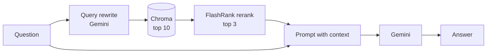

# generic-rag

[](https://github.com/musksah/generic-rag/actions/workflows/ci.yml)

A minimal **advanced RAG** service in about 200 lines of Python. It shows two
techniques that improve on plain vector search, wired together with
LangChain, Chroma and Gemini on Vertex AI:

1. **Pre-retrieval query rewriting.** The LLM turns the user's question into a
   statement that matches how the answer is phrased in the source text.
2. **Post-retrieval reranking.** Chroma returns the top 10 candidate chunks,
   and [FlashRank](https://github.com/PrithivirajDamodaran/FlashRank), a small
   cross-encoder that runs locally on CPU, keeps the best 3 before they reach
   the prompt.

The sample corpus is the 2024 State of the Union address, which is public
domain. Swap in your own text to reuse the pipeline.

## How it works



| File | Role |
|---|---|
| `main.py` | FastAPI app: `/ingest/`, `/chat/`, `/health_chroma` |
| `packrag/config.py` | All settings, read from environment variables |
| `packrag/chromap.py` | Chroma HTTP client, Vertex AI embeddings, vector store |
| `packrag/ingest.py` | Splits the document into 1000-char chunks and upserts them with deterministic ids |
| `packrag/ragchain.py` | `RAGChain`: rewrite, retrieve, rerank, then answer |
| `tests/` | Offline tests (no cloud or Chroma server needed) |

## Requirements

- Python 3.10+
- A Google Cloud project with the **Vertex AI API** enabled, and Application Default Credentials:
  ```bash
  gcloud auth application-default login
  ```

## Quickstart

```bash
python -m venv .venv
source .venv/bin/activate             # Windows: .\.venv\Scripts\Activate.ps1
pip install -r requirements.txt
export GOOGLE_CLOUD_PROJECT=your-project-id
```

Start Chroma and the API in two terminals:

```bash
chroma run --host localhost --port 8000 --path ./chroma_data
uvicorn main:app --port 8080          # 8000 is taken by Chroma
```

Load the document and ask a question:

```bash
curl -X POST http://localhost:8080/ingest/
# {"message": "Information updated", "chunks": 48}

curl -X POST http://localhost:8080/chat/ \
     -H "Content-Type: application/json" \
     -d '{"question": "What did the president say about insulin prices?"}'
# {"answer": "..."}
```

`/ingest/` is idempotent: chunk ids are content hashes, so running it again
overwrites the same chunks instead of duplicating them. If the context doesn't
contain the answer, the model is instructed to say so instead of guessing.

## Configuration

All settings are optional environment variables. See [`.env.example`](.env.example).

| Variable | Default |
|---|---|
| `GOOGLE_CLOUD_PROJECT` | ADC default project |
| `GOOGLE_CLOUD_LOCATION` | `us-central1` |
| `LLM_MODEL` | `gemini-3.5-flash` |
| `EMBEDDING_MODEL` | `text-embedding-005` |
| `CHROMA_HOST` / `CHROMA_PORT` | `localhost` / `8000` |
| `CHROMA_COLLECTION` | `state_of_the_union` |
| `RETRIEVAL_K` / `RERANK_TOP_N` | `10` / `3` |
| `RERANK_MODEL` | `ms-marco-MiniLM-L-12-v2` |
| `DOCUMENT_PATH` | `documents/2024_state_of_the_union.txt` |

If you change `EMBEDDING_MODEL`, also change `CHROMA_COLLECTION` and ingest
again, because vectors from different models can't be compared.

## Using your own documents

Set `DOCUMENT_PATH` to any UTF-8 text file and `CHROMA_COLLECTION` to a new name, then call `/ingest/`.

## Tests

```bash
pip install -r requirements-dev.txt
pytest
```

The tests use an in-memory Chroma, fake embeddings, a fake chat model and a
stub reranker, so they run offline. They cover idempotent ingestion, rerank
ordering, which query each stage receives, and the `/chat/` endpoint.

## Limitations

- Ingests a single plain-text file. There are no PDF or Markdown loaders yet.
- No answer-quality evaluation yet: tests check the wiring, not retrieval quality.

## Roadmap

- [ ] PDF/Markdown loaders and multi-file ingest
- [ ] Retrieval evaluation comparing rewrite on/off and rerank on/off
- [ ] Docker Compose for the API plus Chroma

## License

[MIT](LICENSE)
