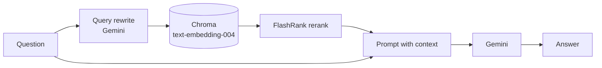

# generic-rag

A minimal **advanced RAG** service in about 150 lines of Python. It shows two
techniques that improve on plain vector search, wired together with
LangChain, Chroma and Gemini on Vertex AI:

1. **Pre-retrieval query rewriting.** The LLM turns the user's question into a
   statement that matches how the answer is phrased in the source text.
2. **Post-retrieval reranking.** Chroma returns candidate chunks, and
   [FlashRank](https://github.com/PrithivirajDamodaran/FlashRank), a small
   cross-encoder that runs locally on CPU, reorders them before they reach the
   prompt.

The sample corpus is the 2024 State of the Union address, which is public
domain. Swap in your own text to reuse the pipeline.

## How it works



| File | Role |
|---|---|
| `main.py` | FastAPI app: `/ingest/`, `/chat/`, `/health_chroma` |
| `packrag/chromap.py` | Chroma HTTP client and retriever (Vertex AI embeddings) |
| `packrag/ingest.py` | Splits `documents/2024_state_of_the_union.txt` into 1000-char chunks and stores them |
| `packrag/ragchain.py` | `RAGChain`: query rewrite, then retrieve, then format context, then answer |

## Requirements

- Python 3.10+
- A Google Cloud project with the **Vertex AI API** enabled, and Application Default Credentials:
  ```bash
  gcloud auth application-default login
  ```

## Quickstart

```bash
python -m venv venv
source venv/bin/activate            # Windows: .\venv\Scripts\Activate.ps1
pip install fastapi uvicorn "langchain<1.0" langchain-community langchain-chroma \
            langchain-google-vertexai langchain-text-splitters chromadb flashrank
```

Set your project id in `PROJECT_ID` in `main.py`. Then use two terminals:

```bash
# 1. Chroma server (the app expects it on localhost:8000)
chroma run --host localhost --port 8000 --path ./chroma_data

# 2. API, on a different port because Chroma already uses 8000
uvicorn main:app --port 8080
```

Run both from the repo root, because the ingest path is relative.

```bash
# Load the document into Chroma (run once: re-running adds duplicate chunks)
curl -X POST http://localhost:8080/ingest/

# Ask a question
curl -X POST http://localhost:8080/chat/ \
     -H "Content-Type: application/json" \
     -d '{"question": "What did the president say about insulin prices?"}'
```

Response:

```json
{"answer": "..."}
```

If the context doesn't contain the answer, the model is instructed to say so
instead of guessing.

## Using your own documents

Replace the file read in `packrag/ingest.py` and change `collection_name` in
`packrag/chromap.py` so the new chunks don't mix with the sample ones.

## Limitations

This is a learning project, not a production service:

- Configuration (project id, Chroma host and port, model names) is hardcoded.
- Ingesting is not idempotent: every call to `/ingest/` adds the same chunks again.
- There are no tests and no pinned dependency file yet.
- Only plain-text input is supported.

## Roadmap

- [ ] `requirements.txt` with pinned versions and `.env`-based configuration
- [ ] Idempotent ingest (deterministic chunk ids) and PDF/Markdown loaders
- [ ] Retrieval evaluation comparing rewrite on/off and rerank on/off
- [ ] Docker Compose for the API plus Chroma

## License

<!-- TODO: add a LICENSE file (MIT is a common choice) and link it here -->
